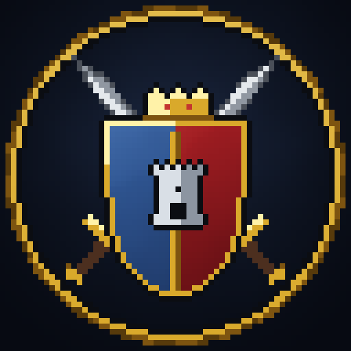

# Nations & War



A Towny-style mod for NeoForge 1.21.1. It has:
- towns that claim land chunk by chunk;
- provinces, nations with a government of their choice, and alliances;
- editable rank trees with permissions;
- siege wars that restore every block when they end;
- NPC nations grown from villages, with courts of named characters and an AI that conquers, defends and liberates.

Everything is managed from one in-game menu or from commands. Claims show on the menu's map, JourneyMap and Xaero's maps, coloured by nation, province, town or alliance, with the names written across the land.

The player-facing description (features, requirements, getting started) is in [`branding/modrinth.md`](branding/modrinth.md).

## Requirements

- Minecraft 1.21.1, NeoForge 21.1.221+
- No required dependencies.
- JourneyMap and Xaero's World Map / Minimap are optional.
- Needed on both the server and the clients.

## Commands

| command | what for |
|---|---|
| `/town …` | `new`, claim, unclaim, invite, join, leave, kick, flags, perms, roles, bank, spawn |
| `/province …` | create, add or remove towns, capital, governor, rename, color |
| `/nation …` | `new <government> <name>`, invite, join, leave, capital, leader, government, roles, bank |
| `/alliance …` | create, invite, join, kick, leave |
| `/war …` | declare, peace, surrender, terms, confirm |
| `/nw` | opens the management menu (also the **N** key) |
| `/nwadmin …` | operators: `bypass` protection, `npc create` an NPC town, `endwars` |

## For other mods

There is a public API in `org.papiricoh.nationsandwar.api`:
- **Managed nations** run by another mod.
- **NeoForge events** for towns, nations, alliances and wars. The declaration of war can be cancelled.
- **A war API**: declare, score, take a town's heart, plant banners, and resolve which nation an entity fights for.
- **Protection-free zones** for boss arenas.
- **Reserved land.**

Read [`docs/API.md`](docs/API.md). To compile against it:
1. Run `./gradlew publishToMavenLocal` here.
2. In your mod, use `compileOnly "org.papiricoh:nationsandwar:<version>"` with `mavenLocal()`. You can also copy the jar from `build/libs/` instead.
3. Declare the dependency as `optional` in your `neoforge.mods.toml`.

## Development

Java 21. The technical guide for the codebase is [`CLAUDE.md`](CLAUDE.md): the package map, how to add actions, the tests and their pitfalls, and the preview harness. The contract for client work is [`docs/CONTRACT.md`](docs/CONTRACT.md).

```bash
./gradlew build                 # compile + JUnit
./gradlew runGameTestServer     # GameTests
./gradlew runClient             # dev client (-Pjm / -Pxaero load JourneyMap / Xaero's)
NW_PREVIEW=gui:overview ./gradlew runClient -Ppreview   # screenshots to runs/client/screenshots/
```

### Art and text (generated by code, dependency-free Python)

```bash
python3 tools/artgen/nwart.py      # entities, blocks, items
python3 tools/artgen/guiart.py     # GUI textures and icons
python3 tools/artgen/noticeart.py  # notice cards
python3 tools/artgen/logo.py       # the logo (branding/ and the in-game mod list)
python3 tools/lang/genlang.py      # en_us.json and es_es.json
```

Never edit generated PNG or lang JSON by hand: change the script and regenerate.

## Releases

Bump `mod_version` in `gradle.properties` and push to `main`. The workflow then builds, runs JUnit and the GameTests, and publishes a GitHub release with the jar (`.github/workflows/release.yml`).

## License

MIT.
